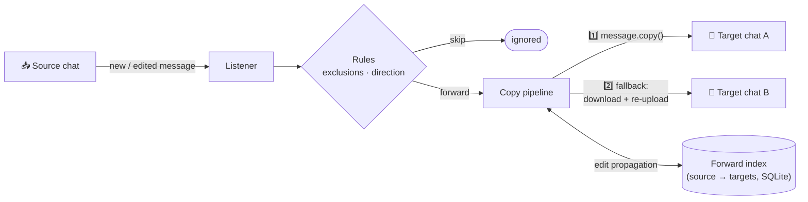
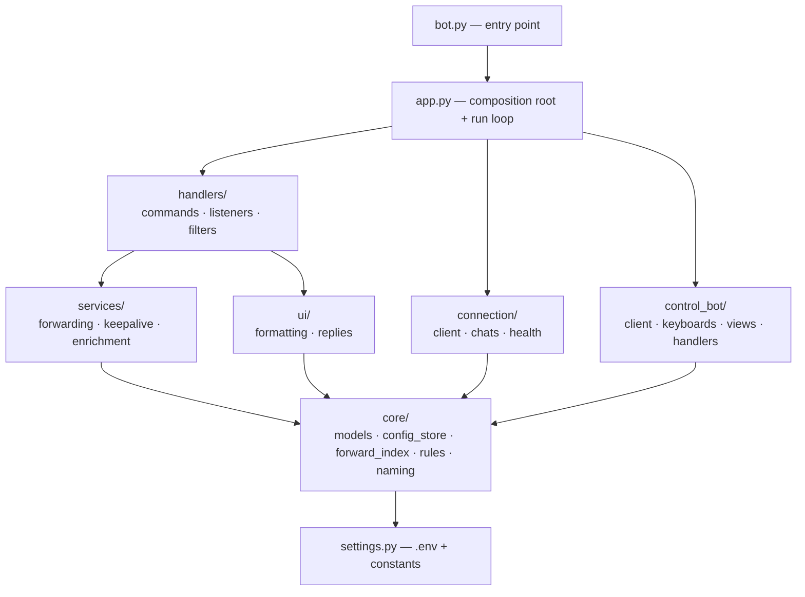

<div align="center">


# Telegram Forwarder

**A self-healing Telegram userbot that mirrors messages between chats — copies, edits, read-states and all — even from copy-protected channels. Controlled from your own account or purely via config file.**

[](https://www.python.org/)
[](https://telegramplayground.github.io/pyrogram/)
[](https://mypy-lang.org/)
[](https://docs.astral.sh/ruff/)
[]()

</div>

---

## Table of Contents

- [Features](#features)
- [How It Works](#how-it-works)
- [Installation](#installation)
  - [Option 1 — Clone & run (no install)](#option-1--clone--run-no-install)
  - [Option 2 — pipx (recommended for a CLI)](#option-2--pipx-recommended-for-a-cli)
  - [Option 3 — pip](#option-3--pip)
  - [First start](#first-start)
- [Configuration](#configuration)
  - [Environment (.env)](#environment-env)
  - [Runtime config (bot_config.json)](#runtime-config-bot_configjson)
  - [Headless mode (no chat commands)](#headless-mode-no-chat-commands)
- [Chat Commands](#chat-commands)
  - [Restricting commands to one chat](#restricting-commands-to-one-chat)
- [Control Bot](#control-bot)
- [Architecture](#architecture)
- [Reliability](#reliability)
- [Development](#development)

## Features

- **Chat-to-chat forwarding** — copies messages (text and every media type) from source chats into any number of target chats.
- **Works with copy-protected chats** — channels and groups with *"Restrict saving content"* enabled (typical for premium/paid channels) block normal forwarding and copying; the re-upload fallback mirrors them anyway, for every media type.
- **Two-stage copy fallback** — tries Telegram's native `copy` first; when that is blocked, it transparently downloads and re-uploads the media as a fresh message.
- **Edit propagation** — text and media edits are mirrored into active targets; optionally recent edit history is rendered into the message (`store_edits`), keeping the newest versions that fit Telegram's limits.
- **Direction filters & exclusions** — forward only incoming, only outgoing, or both (`copy_incoming` / `copy_outgoing`); skip messages matching `fnmatch` patterns.
- **View-once mode** — a per-chat setting (`view_once`) for self-destructing media (view-once photos & videos, listen-once voice/video notes): `off` skips them, `on` forwards them alongside everything else, `only` forwards *nothing but* them. In `on`/`only` they are archived as regular, persistent media in the target chat before they can burn.
- **Sender attribution** — optionally prefix copied text with the original sender's name (`--name-prefix`).
- **Read-state mirroring** — when you read a source chat, its targets are marked read too; optionally targets are flagged *unread* on fresh copies (`mark_target_unread`).
- **Daily keep-alives** — per-chat daily messages with a random time offset, message pools, and `{timestamp}` / `{date}` / `{time}` placeholders.
- **Hot-reload** — `bot_config.json` is reloaded on change without a restart; a corrupt edit never crashes the bot.
- **Self-healing** — active health-check with hard-exit for supervisor restarts, plus a two-layer reconnect strategy.
- **Scheduled commands** — slash commands work from Telegram's scheduled-messages view, with replies that never leak to the chat partner.
- **Optional control bot** — a separate BotFather bot with an inline-button menu: live status with connection health, pause/resume whole listeners or individual targets, toggle per-chat settings (direction, view-once, keep-alive, …), change keep-alive times, and add or delete rules by picking from your recent chats — all locked to your own user id.
- **Fully headless if you want** — one env switch disables all chat commands; the bot then runs purely off the JSON config.

## How It Works

The bot logs in as a regular **user account** (userbot, not a bot account) and listens to its own message stream:



Copied messages are tracked in `session/forward_index.sqlite3`, so later **edits** still reach the exact target messages after a restart. Edits apply in place when possible; any replacement is sent successfully before the old copy is deleted. Paused or removed targets receive no edits. Updates for unknown messages (including messages copied before this database existed) are ignored instead of creating duplicate copies.

Because the fallback re-uploads content as fresh messages, even chats with Telegram's content protection ("Restrict saving content", common in premium channels) can be mirrored — where native forwarding and copying are refused by the API.

## Installation

Requires **Python 3.12+**. Pick whichever style you prefer — all of them end up with the same bot.

### Option 1 — Clone & run (no install)

```bash
git clone https://github.com/bjspi/telegram-forwarder.git
cd telegram-forwarder
pip install -r requirements.txt
python bot.py
```

**Update later:**

```bash
git pull
pip install -r requirements.txt   # in case dependencies changed
```

### Option 2 — pipx (recommended for a CLI)

[pipx](https://pipx.pypa.io/) installs the bot into its own isolated environment and puts a `telegram-forwarder` command on your PATH:

```bash
pipx install git+https://github.com/bjspi/telegram-forwarder.git
telegram-forwarder
```

**Update later:**

```bash
pipx upgrade telegram-forwarder
```

### Option 3 — pip

Straight from GitHub, no checkout needed:

```bash
pip install git+https://github.com/bjspi/telegram-forwarder.git
telegram-forwarder
```

**Update later:** `pip install -U --force-reinstall git+https://github.com/bjspi/telegram-forwarder.git`

Or as an **editable install** from a checkout (best for hacking on the code — `git pull` is the whole update):

```bash
git clone https://github.com/bjspi/telegram-forwarder.git
cd telegram-forwarder
pip install -e .
telegram-forwarder      # or still: python bot.py
```

### First start

The bot reads its credentials from a `.env` file in the working directory:

```bash
cp .env.example .env    # Windows: copy .env.example .env
# then fill in TG_ACCOUNT, TG_PHONE_NR, TG_API_ID, TG_API_HASH
# (get API id + hash at https://my.telegram.org/auth?to=apps)
```

The first start walks you through the Pyrogram login (phone number + code) and creates `session/`, `logs/` and `bot_config.json`. Those contain secrets or private data and are all gitignored.

> [!TIP]
> `tgcrypto` (included in the dependencies) speeds up MTProto encryption massively — make sure it is installed in the active environment.

## Configuration

### Environment (.env)

Everything an operator tunes lives in `.env` — every variable is documented in [`.env.example`](.env.example). The important ones:

| Variable | Default | Purpose |
| --- | --- | --- |
| `TG_ACCOUNT`, `TG_PHONE_NR`, `TG_API_ID`, `TG_API_HASH` | — | **Required** Telegram credentials; startup aborts with a clear error if missing. |
| `ENABLE_CHAT_COMMANDS` | `true` | Master switch for all slash commands (see [headless mode](#headless-mode-no-chat-commands)). |
| `COMMANDS_CHAT_ID` | `0` | Restrict commands to a single chat id; `0` = every chat (see [command scope](#restricting-commands-to-one-chat)). |
| `CONTROL_BOT_TOKEN` / `CONTROL_BOT_OWNER_ID` | — | Optional BotFather control bot and its sole owner (see [Control Bot](#control-bot)). |
| `TIMEZONE` | `Europe/Berlin` | Keep-alive scheduling and log timestamps. |
| `DELETE_DELAY_SECONDS` | `5` | Auto-delete delay for command replies. |
| `FORWARD_RECORD_TTL_SECONDS` | `86400` | Lifetime of cached mappings in RAM; persistent mappings remain available for later edits. |
| `HEALTH_CHECK_INTERVAL_SECONDS` / `MAX_UNHEALTHY_DURATION_SECONDS` | `60` / `900` | Health-check cadence and the hard-exit threshold. |
| `LOG_RETENTION_DAYS` | `10` | Daily log files older than this are deleted automatically. |

### Runtime config (bot_config.json)

Listener and keep-alive rules live in `bot_config.json`. It is normally managed through chat commands, but you can also edit it by hand — the file is **hot-reloaded** on change, missing fields are migrated transparently, and a corrupt edit simply keeps the previous in-memory state.

```jsonc
{
  "listeners": [
    {
      "source_chat_id": -1001234567890,
      "target_chats": [{ "chat_id": -1009876543210, "chat_name": "My Archive" }],
      "exclusions": ["*spoiler*"],   // fnmatch patterns on text/caption
      "name_prefix": false,
      "copy_incoming": true,
      "copy_outgoing": true,
      "store_edits": false,
      "mark_target_unread": false,
      "view_once": "off"             // "off" skip · "on" include · "only" exclusive
    }
  ],
  "keepalives": [
    {
      "chat_id": 123456789,
      "time_of_day": "08:00:00",
      "time_of_day_delta": 1.5,      // random ± offset in hours, per day
      "message_text": ["Good morning {date}!", "Ping ({time})"]
    }
  ]
}
```

### Headless mode (no chat commands)

Maybe you don't want the bot reacting to anything typed in chats — you'd rather configure everything centrally in the JSON file. Set:

```dotenv
ENABLE_CHAT_COMMANDS=false
```

With commands disabled, **no command handlers are registered at all**: the bot is purely passive, only forwards according to `bot_config.json`, and slash messages you type stay untouched. Forwarding, keep-alives, hot-reload and the health-check are unaffected.

## Chat Commands

With `ENABLE_CHAT_COMMANDS=true` (the default), the bot is controlled from your own account. Commands are gated by `filters.me` — only *your own* slash messages trigger anything, and every command plus its reply deletes itself after a short delay.

| Command | Effect |
| --- | --- |
| `/helpf` | Show the help text. |
| `/show_id` | Show the current chat id. |
| `/list_chats` | List the 20 most recent chats with type, name and id. |
| `/config` · `/config <source>` · `/config all` | Show listener configuration. |
| `/copy <target> [more...] [--name-prefix] [--view-once=off\|on\|only]` | Use the current chat as source and add targets. |
| `/copy <source> <target> [more...]` | Create a rule from any chat. |
| `/stop` · `/stop <source>` · `/stop <source> <target>` | Remove listeners or single connections. |
| `/keepalive [HH:MM:SS]` · `/keepalive pause` · `/keepalive off` | Manage the chat's daily keep-alive. |

**Scheduled commands:** commands sent from Telegram's scheduled-messages view are answered *back into the scheduled queue* — the reply stays visible for 30 seconds, starts with `(AutoDelete in 30s)`, and is then removed together with the command, so it never reaches the chat partner.

### Restricting commands to one chat

By default the command handlers listen in **every** chat (as long as *you* send the slash command). If you'd rather keep them out of your normal conversations, point `COMMANDS_CHAT_ID` at a single chat — typically a **private group containing only yourself** — and the handlers are registered *scoped to that chat only*:

```dotenv
COMMANDS_CHAT_ID=-1001234567890
```

Now `/copy`, `/stop`, `/keepalive` etc. only do anything in that one group; the same slash command typed anywhere else is left completely untouched. Forwarding, keep-alives and everything else keep working across all configured chats regardless. To find the id, run `/show_id` in the target group. Set it back to `0` to allow commands everywhere again.

> **How to make a group with just yourself:** create a new group, add any contact, then remove them again — Telegram keeps the group with you as the only member. It's the tidiest command console for a userbot.

## Control Bot

Optionally, a **separate BotFather bot** gives you an inline-button menu to inspect the configuration and flip per-chat settings — no need to type slash commands into a chat. It runs alongside the userbot in the same process and edits the same live config, so changes take effect immediately.

Set it up with two variables:

```dotenv
CONTROL_BOT_TOKEN=123456:ABC-DEF...      # from @BotFather
CONTROL_BOT_OWNER_ID=123456789           # your own numeric user id
```

Then send `/menu` to your bot. Every screen is **locked to `CONTROL_BOT_OWNER_ID`** — the bot ignores everyone else, and it refuses to start at all if no owner is set. The menu lets you:

- **📊 Status** (also directly via `/status`) — connection health (time since the last successful Telegram check) plus every listener and keep-alive with its live ▶️/⏸ state, target counts and settings — with a 🔄 Refresh button.
- **📡 Listeners** — every source chat as a button with its ▶️/⏸ state and target count. Inside a listener:
  - **⏸ Pause / ▶️ Resume** — a master switch per listener; a paused listener keeps all its settings but forwards nothing.
  - **🎯 Targets** — manage each target individually: pause/resume it with one tap (reversible, the reference is kept), 🗑 remove it for good (with a confirm screen), or **➕ Add target** via the recent-chats picker.
  - **Direction** — incoming · outgoing · both
  - **View-once media** — off · on · only
  - **Name prefix**, **Store edits**, **Mark target unread**
  - **Keep-alive** — enable/disable the chat's daily ping (if one exists)
  - **🗑 Delete listener** — remove the whole rule, behind a confirm screen
- **⏰ Keep-alives** — per row: toggle with one tap, **🕒 change the time**, or **🗑 delete** (with confirm). **➕ Add keep-alive** builds a new one.

**Creating rules from the menu:** *Add listener*, *Add target* and *Add keep-alive* walk you through a short flow. For each chat you either **pick from your 20 most recently active chats** (the userbot fetches them live — no need to remember ids) or **type a chat id / @username**, which is verified by resolving it before anything is saved. Keep-alive times are entered as `HH:MM:SS` and validated. **Destructive actions always show a confirm screen first** — and wherever pausing would do, the confirm text says so. Message pools and exclusions are still configured with the userbot's commands or by editing `bot_config.json`.

The control bot also registers its own command menu (`/menu`, `/status`, `/start`) via the Bot API, so the commands show up in Telegram's UI.

## Architecture

`bot.py` is a thin entry point; the application is the `telegram_forwarder` package right next to it (flat layout, same pattern as yt-dlp or HTTPie) — so both *clone & run* and *pip/pipx install* work naturally.



```
bot.py                        # entry point: imports the package and runs the app
telegram_forwarder/
├── settings.py               # .env loading, credentials, all tuning constants
├── logging_setup.py          # daily log files with retention, logging config
├── app.py                    # composition root: client + scheduler + handlers + run loop
├── core/                     # domain: models, config store, forward index, message rules
├── connection/               # Pyrogram client factory, chat resolution, health check
├── services/                 # forwarding pipeline, keep-alive scheduling, name enrichment
├── handlers/                 # Pyrogram handlers: slash commands + message listeners
├── control_bot/              # optional BotFather bot: inline-menu config UI
└── ui/                       # reply formatting and auto-delete replies
```

## Reliability

Built to run unattended under a process supervisor (supervisord, systemd, NSSM, …):

1. **Outer reconnect loop** — network/RPC errors during startup trigger a retry after `NETWORK_RETRY_DELAY_SECONDS`.
2. **Active health check** — Pyrogram retries connection failures *internally* without ever raising, which can leave a bot silently dead. A periodic `get_me()` ping detects this. A failed ping triggers a WAN probe (Google's/Cloudflare's `generate_204` endpoints, contacted only while Telegram is already unreachable) that classifies the outage: **internet down** pauses the give-up clock — a restart cannot bring the line back — while **internet up, Telegram unreachable** lets it run. Only after `MAX_UNHEALTHY_DURATION_SECONDS` (default 15 min) of continuous Telegram-only failure does the process hard-exit (`os._exit(1)`) so the supervisor restarts it — the stuck-session case a restart actually fixes.
3. **Crash forensics** — unexpected fatal errors are written to `logs/critical_error_*.txt`; daily logs rotate at midnight and expire after `LOG_RETENTION_DAYS`.

## Development

```bash
pip install ruff mypy
ruff check bot.py telegram_forwarder    # lint / bug finder
mypy bot.py telegram_forwarder          # static type check
```

Both tools are configured in [`pyproject.toml`](pyproject.toml). Project conventions: type hints and docstrings on every function, `@dataclass(slots=True)` for state containers, and everything operator-tunable lives in `.env`.

---

> [!NOTE]
> This is a **userbot**: it logs in with your own Telegram account via the MTProto API. Use it responsibly and in accordance with [Telegram's Terms of Service](https://telegram.org/tos) — aggressive automation can get accounts limited.

## Network outage behaviour

This host sits on a home connection, so a WAN outage is routine. All bots on it
follow the same schema (see `_template_/CLAUDE.md`):

- Connecting never gives up after N attempts - Pyrogram keeps reconnecting.
- The health watchdog gives up on a **duration** (900s of continuous failure),
  never on a plain failure count: a counter would restart the process every few
  minutes through an hours-long outage and gain nothing by it.
- A **WAN outage pauses the give-up clock**: the `generate_204` probe separates
  "the line is dead" (wait it out) from "Telegram alone is unreachable" (a
  restart plausibly helps). The probe only runs while the Telegram check is
  already failing, so normal operation generates no extra traffic.
- Giving up means a hard exit for the supervisor, not silently running on.
- Transient errors are logged throttled but never invisibly: a window in which
  the bot receives nothing has to be visible in the log.
